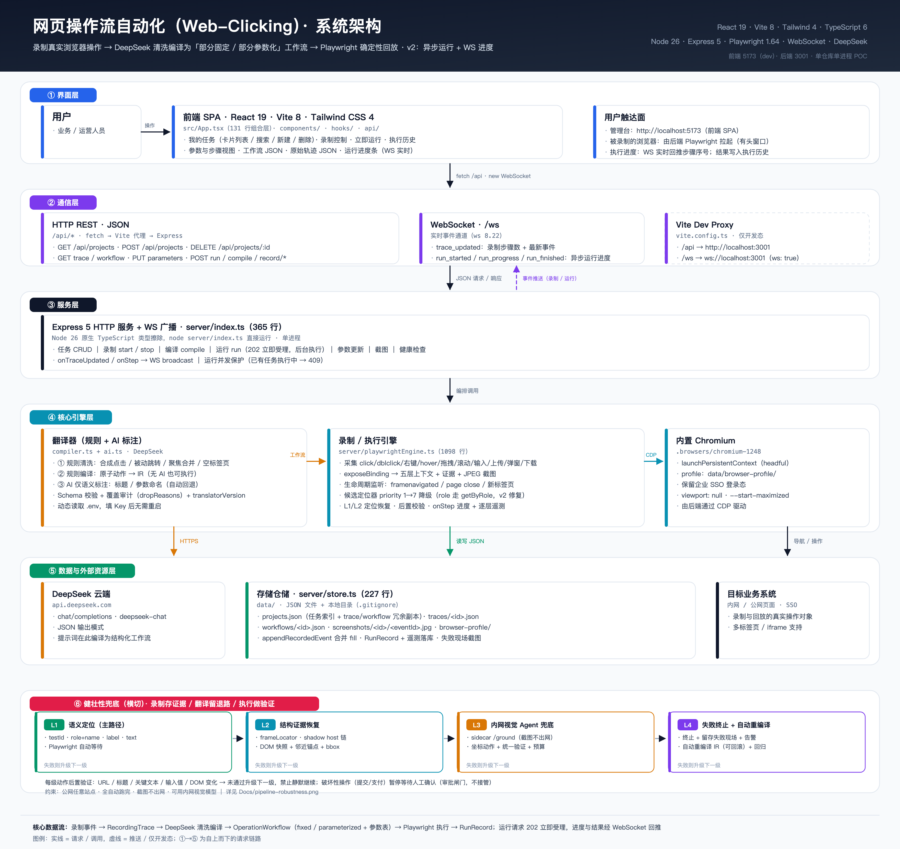
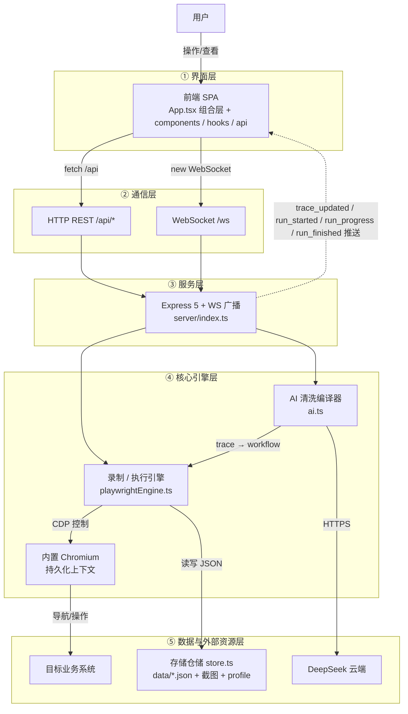
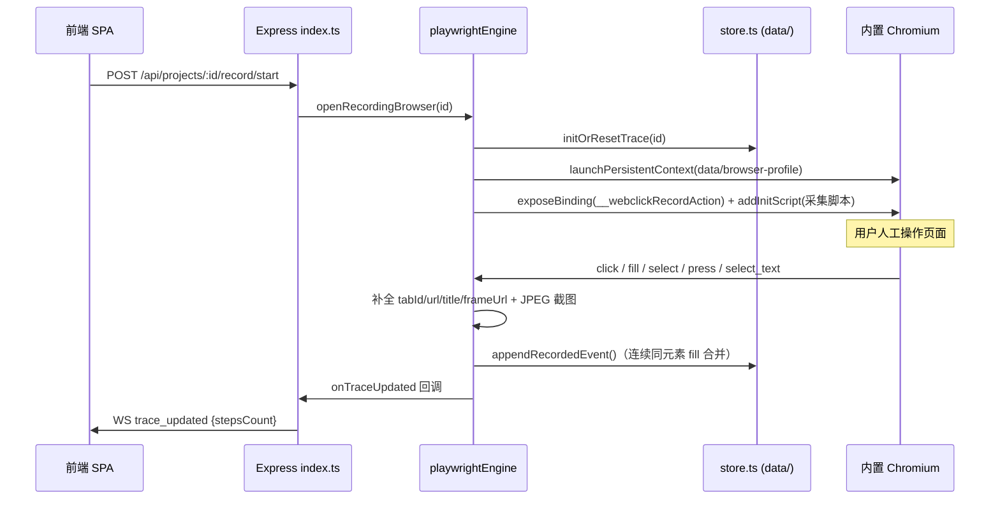
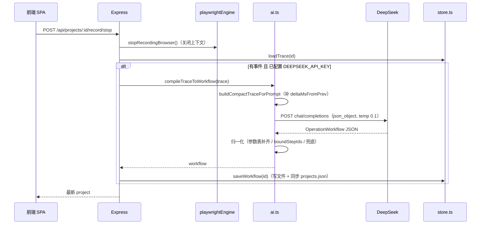
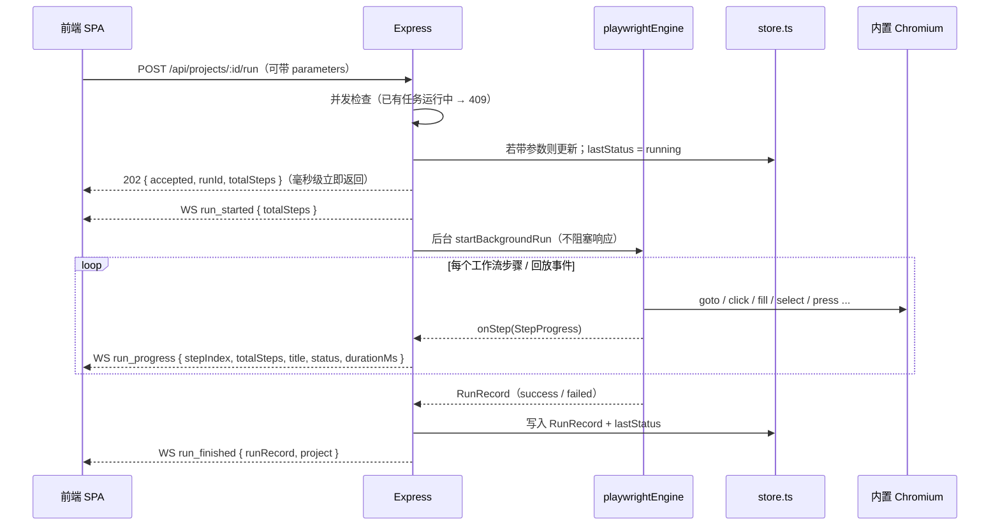

# 网页操作流自动化（Web-Clicking）· 系统架构

> 仓库：`showboat-dev/Web-clicking` · 分支 `main@b4a90c1` · 文档更新：2026-10-18
>
> **v2 重构**：前后端统一 `shared/types.ts` 契约 · `App.tsx` 拆分为组件/hooks/api · 运行改为异步任务 + WebSocket 进度推送
>
> **健壮性设计（v3 方向）**：录制 / 翻译 / 执行的能力边界与 L1–L4 兜底方案 → [`PIPELINE-ROBUSTNESS.md`](./PIPELINE-ROBUSTNESS.md) · 图 [`pipeline-robustness.png`](./pipeline-robustness.png)
>
> **L3 视觉 Agent**：协议 / sidecar / 执行器钩子 / 预算与安全约束 → [`L3-VISUAL-AGENT.md`](./L3-VISUAL-AGENT.md)
>
> **测试与真站回归**：测试分层、真站矩阵与已修复缺陷 → [`TESTING.md`](./TESTING.md)



> 矢量版：[`architecture.svg`](./architecture.svg)（可无损缩放/打印）

## 1. 一句话定位

把「人在浏览器里的真实操作」录下来，交给大模型清洗成 **「部分固定、部分参数化」的工作流**，再由 Playwright **100% 确定性回放**；每次运行前还能改参数重跑。

核心价值闭环：

```
录制（原始噪声事件） → AI 清洗/参数抽象（可读可配的工作流） → Playwright 确定性执行（可复用、可参数化）
```

## 2. 技术栈

| 层 | 技术 | 说明 |
|---|---|---|
| 前端 | React 19.2 · Vite 8.3 · Tailwind CSS 4.3 · lucide-react | SPA，无路由；组件化 + 自定义 hooks |
| 语言 | TypeScript 6（app / node 两个 project） | 后端依赖 Node 26 原生类型擦除直接运行 `.ts` |
| 契约 | `shared/types.ts` | 前后端唯一类型来源，`server/types.ts` 仅做兼容 re-export |
| 后端 | Node 26.10 · Express 5.3 · ws 8.22 | 单进程 HTTP + WebSocket 服务 |
| 自动化 | Playwright 1.64.1（自带 Chromium `chromium-1248`） | 持久化上下文 `launchPersistentContext`，有头模式 |
| AI | DeepSeek `chat/completions`（`deepseek-chat`） | `response_format=json_object`，temperature 0.1 |
| 工程 | oxlint · `tsc -b && vite build` | 无测试、无 CI |

## 3. 全局架构



## 4. 分层职责

| 层 | 模块 | 职责 |
|---|---|---|
| 界面层 | [`src/App.tsx`](../src/App.tsx)（131 行） | 组合层：搜索过滤、弹窗开关、任务卡片列表装配 |
| UI 组件 | [`src/components/`](../src/components/) | `TaskCard`（含异步运行进度条）、`CreateTaskModal`、`WorkflowModal`、`HistoryModal`、`Modal`（弹窗外壳）、`ErrorToast` |
| 前端数据层 | [`src/hooks/useProjects.ts`](../src/hooks/useProjects.ts) · [`src/api/client.ts`](../src/api/client.ts) | 任务状态、WebSocket 订阅（含断线重连与补拉）、运行进度映射、CRUD/录制/运行动作；类型化 fetch 封装与错误归一化 |
| 通信层 | [`vite.config.ts`](../vite.config.ts) | 开发态把 `/api`、`/ws` 反代到 `localhost:3001`（`changeOrigin`、`ws: true`） |
| 服务层 | [`server/index.ts`](../server/index.ts)（365 行） | REST 路由、WS 广播、录制生命周期编排、录制结束自动 AI 编译、**异步运行任务编排** |
| 引擎层 | [`server/playwrightEngine.ts`](../server/playwrightEngine.ts)（1098 行） | DOM 采集脚本注入、事件→主进程回调、五层上下文补全、截图、定位器解析、工作流执行 / 轨迹回放、**步骤进度回调** |
| 翻译层 | [`server/compiler.ts`](../server/compiler.ts) + [`server/ai.ts`](../server/ai.ts) | 确定性规则清洗/编译（`compiler.ts`）+ AI 语义标注（`ai.ts`），AI 失败自动回退规则生成；含覆盖审计与 `translatorVersion` |
| 存储层 | [`server/store.ts`](../server/store.ts) | `data/` 目录初始化、JSON 读写、连续 `fill` 合并、参数双写、`stepsCount` 同步 |
| 契约层 | [`shared/types.ts`](../shared/types.ts)（208 行） | 前后端共用领域类型：`RecordedEvent` / `RecordingTrace` / `OperationWorkflow` / `Project` / `StepProgress` / `ServerMessage` |
| 健壮性（横切，设计中） | [`Docs/PIPELINE-ROBUSTNESS.md`](./PIPELINE-ROBUSTNESS.md) | 录制证据包 / 翻译器确定性清洗 / 执行器 L1–L4 兜底 / 验证器 / 反馈闭环；含差距清单与路线图 |

## 5. 目录结构

```
.
├── shared/
│   └── types.ts             # ★ 前后端共用类型契约（含 WS 消息协议）
├── src/
│   ├── App.tsx              # 组合层（131 行，仅组织布局与弹窗）
│   ├── api/client.ts        # 类型化 fetch 封装 + ApiError
│   ├── hooks/useProjects.ts # 任务状态 / WS 订阅（自动重连）/ 运行进度 / 动作集合
│   ├── components/
│   │   ├── Modal.tsx            # 统一遮罩 + 弹窗外壳
│   │   ├── TaskCard.tsx         # 任务卡片（运行进度条在此）
│   │   ├── CreateTaskModal.tsx  # 新建任务表单
│   │   ├── WorkflowModal.tsx    # 参数与步骤视图 / 原始与清洗后 JSON
│   │   ├── HistoryModal.tsx     # 执行历史
│   │   └── ErrorToast.tsx       # 全局错误提示
│   ├── main.tsx             # React 入口
│   ├── index.css            # 仅 @import "tailwindcss"
│   ├── App.css              # ⚠ Vite 模板残留，未被引用
│   └── assets/              # ⚠ 模板残留（hero.png / react.svg / vite.svg）
├── server/
│   ├── index.ts             # Express + WS + 路由编排 + 后台运行任务（365 行）
│   ├── playwrightEngine.ts  # 录制与执行引擎（1098 行，核心）
│   ├── ai.ts                # AI 语义标注 + 证据增强 + 校验生成
│   ├── compiler.ts          # 确定性规则清洗 / 规则编译 / 覆盖审计
│   ├── visualAgent.ts       # L3 视觉 Agent 客户端（配置/预算/健康检查）
│   ├── store.ts             # JSON 文件仓储（227 行）
│   └── types.ts             # 兼容入口：re-export shared/types.ts
├── visual-agent/
│   └── server.py            # L3 内网视觉 Agent sidecar（mock + 真实模型接入点）
├── public/                  # favicon.svg（在用）；icons.svg（⚠ 模板残留）
├── data/                    # 运行时数据（.gitignore，见 §9）
├── .browsers/               # 项目自带 Chromium（.gitignore）
├── Docs/                    # 本文档与架构图
├── dist/                    # 生产构建产物（.gitignore）
├── index.html               # 标题「网页操作流自动化」
├── vite.config.ts           # 代理 + Tailwind + React + 轮询 watch
├── .env / .env.example      # DeepSeek 配置（.env 已忽略）
├── tsconfig.app.json        # include: src + shared
├── tsconfig.node.json       # include: server + shared + vite.config
└── package.json             # dev / server / build / lint
```

## 6. 核心数据模型

系统里只有 **两个核心 JSON 契约**，它们之间是「原始 → 清洗后」的转换关系；再加上一份运行/WS 协议，全部定义在 [`shared/types.ts`](../shared/types.ts)。

### 6.1 `RecordingTrace` —— 原始录制轨迹（清洗前）

每条 `RecordedEvent` 刻意设计成 **五层结构**，目的是让大模型有足够上下文做降噪和定位：

| 层 | 字段 | 内容 |
|---|---|---|
| 1. 时间与页面上下文 | `pageContext` | `tabId` / `tabIndex` / `url` / `title` / `frameUrl` / `frameChain`（多层 iframe 链）/ `viewport` |
| 2. 动作本身 | `action` | `category`（window/page）+ `type`（tab_open / tab_close / navigate / click / fill / select / select_text / press）+ `value` / `key` |
| 3. 操作对象 | `target` | 标签名、role、innerText、nearbyLabel、attributes、**候选定位器数组**、boundingBox、`shadowChain`（open shadow host 链）、`domSnapshot`（outerHTML 片段） |
| 4. 用户解说 | `userComment` | 边操作边说的语音/文字（预留） |
| 5. 视觉快照 | `screenshotPath` | `data/screenshots/<projectId>/<eventId>.jpg` |

**候选定位器（`CandidateLocator`）是容错核心**，录制时一次性采集 7 种策略，执行时按 `priority` 从小到大逐级降级：

| priority | strategy | 录制来源 | 执行方式 |
|---|---|---|---|
| 1 | `testId` | `data-testid` / `data-test` | `getByTestId` |
| 2 | `id` | 元素 `id`（排除 4 位以上纯数字 id） | `#id`（CSS.escape） |
| 3 | `label` | `<label for>` / 包裹 label / aria-label / placeholder | `getByLabel` |
| 4 | `role` | 显式 role 或按标签推断 | 拆出 `role:name` 后走 `getByRole(role, { name })`（v2 修复） |
| 5 | `text` | 元素文本（≤40 字，button/a/span/label/li） | `getByText` |
| 6 | `css` | 6 层以内、遇到稳定 `id` 即截断的 CSS Path | `locator(css)` |
| 7 | `xpath` | 8 层以内、带索引的 XPath | `locator(xpath)` |

### 6.2 `OperationWorkflow` —— 清洗后的工作流（可执行）

关键设计是 **双表示（Human View / Engine Binding）**，P1 起 `engineBinding` 还携带 `frameChain`、`recovery`（L2 结构恢复证据）与 `verification`（后置校验）；工作流顶层带 `schemaVersion` / `translatorVersion` / `coverage`（翻译覆盖审计）：

```ts
interface WorkflowStep {
  id: string
  order: number
  stepCategory: 'fixed' | 'parameterized'   // 固定硬操作 / 动态抽象操作
  sourceEventIds: string[]                 // 溯源：对应原始事件
  humanView: { title, description, paramKey?, paramLabel? }   // 给人看
  engineBinding: {                          // 给 Playwright 执行
    tabId, frameUrl?, actionType, paramKey?, value?, locators[], timeoutMs, optional?
  }
}

interface OperationWorkflow {
  projectId, updatedAt, summary, removedNoiseCount
  parameters: WorkflowParameter[]           // 项目级动态参数表
  steps: WorkflowStep[]
}
```

**「部分固定、部分抽象」的判定规则**（写死在提示词里，`ai.ts:74`）：

- `fixed`：打开起始网址 `goto`、点击固定按钮、`press` 固定键、`tab_open` / `tab_close`
- `parameterized`：`fill`（输入内容必然可变）、`select`（筛选项通常可变）→ 抽象成顶层参数，如 `searchKeyword`，并登记 `label / description / inputType / defaultValue / value / required / boundStepIds`

### 6.3 `Project` / `RunRecord`

`Project` 是任务视图模型，含 `traceFile`、`workflowFile`，并直接内嵌 `trace`、`workflow` 的完整副本（见 §11 风险）。`RunRecord` 记录 `time / status / duration / note`，最新在前；异步运行下 `RunRecord.id` 统一等于受理时生成的 `runId`。另带 `logs: StepExecutionLog[]` 逐步执行遥测（命中定位策略、耗时、校验结果、失败原因）。

### 6.4 `ServerMessage` —— WebSocket 推送协议

`shared/types.ts` 里用 discriminated union 定义，前后端共享同一份：

| `type` | 方向 | 载荷 |
|---|---|---|
| `connected` | 后端 → 前端 | 连接握手 |
| `trace_updated` | 后端 → 前端 | `projectId` / `stepsCount` / `latestEvent` |
| `run_started` | 后端 → 前端 | `projectId` / `runId` / `totalSteps` / `startedAt` |
| `run_progress` | 后端 → 前端 | `runId` / `stepIndex` / `totalSteps` / `stepId` / `title` / `status` / `durationMs` |
| `run_finished` | 后端 → 前端 | `runRecord` / 最新 `project` |

## 7. 三条关键流程

### 7.1 录制



采集点（注入脚本，`playwrightEngine.ts`）：`click`（捕获阶段，忽略 0 尺寸合成点击）、`input`（密码打码 `******`）、`change`（select）、`keydown`（Enter / Escape）、`mouseup`（≥2 字选词）；窗口级监听 `framenavigated`（navigate）、页面 `close`（tab_close）、`context.on('page')`（tab_open）。

### 7.2 停止录制 → AI 清洗编译



降噪规则是 **双保险**：录制端过滤 0 尺寸合成点击；提示词端再剔除「press 后 100ms 内合成点击」「label 与关联 submit 的 <50ms 连带点击」「click/press 引发的被动 navigate」「聚焦点击 + 同元素 fill 合并」，并要求 locator **原样拷贝、禁止模型编造选择器**。

### 7.3 运行（v2：异步任务 + WS 进度）



执行细节：

- **受理即返回**：`POST /run` 只做校验、参数落库、状态置 `running`，随后 `res.status(202)`，实测受理耗时 < 10ms；真正的执行在 `startBackgroundRun()` 里继续
- **并发互斥**：`getActiveRunProjectId()` 守卫 —— 共用一个持久化浏览器上下文，同一时刻只允许一个任务运行，重复请求返回 `409`
- **进度来源**：引擎 `RunOptions.onStep` 回调；工作流按 `steps.length` 计数，轨迹回放按事件数计数，失败时先上报 `failed` 步骤再抛出
- **结果落库**：`RunRecord.id = runId`，执行结束后写回 `projects.json`，再通过 `run_finished` 把最新 `project` 推给前端（前端不必再轮询）
- **失败处理**：引擎内部捕获异常返回 `status:'failed'` 记录；`run_finished` 后前端弹错误 toast，历史记录里可见失败原因
- **等待策略仍是 POC 级**：click/fill/select 350ms、press 600ms、goto 400ms 固定 sleep，未做智能等待
- **尚不支持取消 / 总超时**：单个动作仍受 `timeoutMs` 约束

### 7.4 前端状态管理（v2 拆分后）

- [`useProjects`](../src/hooks/useProjects.ts) 是唯一的状态源：`projects`、`runProgress`（按 projectId 的进度映射）、`error`
- 单个 WebSocket 连接，**断线自动重连**（1s 起指数退避至 5s），重连成功后重新拉取一次任务列表补齐断线期间的消息
- 消息分发：`trace_updated` → 更新 `stepsCount`；`run_started/progress` → 更新进度与 `running` 状态；`run_finished` → 用后端返回的最新 `project` 覆盖
- 运行进度是「乐观更新 + WS 校正」：点击后立即置 `running` 并显示进度条，WS 事件到达后刷新；受理失败则回滚状态并弹 toast
- 组件各自只关心展示与局部交互：`WorkflowModal` 内部负责 trace/workflow 加载、AI 编译、参数保存；`App.tsx` 只负责弹窗开关与列表装配

### 7.5 健壮性：录制 → 翻译 → 执行的能力边界与分层兜底

v2 解决的是工程结构问题，**尚未解决「录不全 / 译不准 / 跑不稳」**。这部分已单独整理成设计稿与可执行差距清单：

- **本质问题不同**：录制器 = 可观测性问题（closed shadow / canvas / 原生弹窗物理不可观测）、翻译器 = 有损语义压缩问题、执行器 = 可复现性问题；
- **缺的第四段是验证器**：现在不抛异常即算成功，属于假成功；应改为「每步前置条件 + 后置断言，失败升级」；
- **执行器四级兜底**：L1 语义定位（主路径）→ L2 结构证据恢复（`frameChain` / `shadowChain` / DOM 快照 / 邻近锚点 / bbox）→ L3 **内网视觉模型兜底**（截图不出网，模板/OCR 补充 + 后置验证）→ L4 **失败终止 + 自动重编译**（无人工接管）；
- **已确认约束**：录制入口固定为受控浏览器（不做真实浏览器扩展）· 目标为公网任意站点 · 全自动跑完 · 提交/支付/删除需人工确认 · 截图与 DOM 快照不得出网，允许内网/本地视觉模型；
- **翻译器改造方向**：确定性规则清洗 + AI 只做语义标注，补 JSON Schema、事件覆盖审计、`confidence` / `provenance`、翻译器版本化；
- **录制器改造方向**：证据包 v2（`frameChain` / `shadowChain` / DOM 快照片段 / 前后截图 / viewport / outcome 证据）+ `observability` 标注 + 录制能力契约。

**真站回归已完成（2026-10-18）**：5 个公开站点（example.com / selenium web-form / Wikipedia / Hacker News / 百度）跑通「录制 → AI 编译 → 执行 → 稳定性复跑」，另覆盖 replay、L2、L3 mock、失败注入专项，结果 **42 通过 / 0 失败 / 1 跳过（百度反爬）**。期间修复 5 类真实缺陷：导航型点击丢失、URL 校验过严、nearbyLabel 误取、候选定位歧义、按键瞬时不可用。详见 [`TESTING.md`](./TESTING.md)。

**L3 视觉 Agent MVP 已落地（2026-10-18）**：新增 `visual-agent/server.py`（mock sidecar，`/health` + `/ground`）与 `server/visualAgent.ts` 客户端；执行器在 L1/L2 失败后按配置触发视觉兜底，坐标点击/输入后走统一验证器，`tier=L3` 进入遥测；预算（单步 1 次、单次运行 3 次）、置信度阈值 0.6、服务不可用快速降级；参考截图与 bbox 来自录制证据。详见 [`L3-VISUAL-AGENT.md`](./L3-VISUAL-AGENT.md)。

**P2 翻译器改造已落地（2026-10-18）**：`server/compiler.ts` 承担确定性清洗（合成点击 / 被动跳转 / 聚焦合并 / 空标签页 / 悬停噪声）与规则编译；AI 只输出 summary、标题说明与参数命名，必须通过 Schema 校验且覆盖全部 stepId；AI 不可用或失败时自动回退 `rules-only` 工作流；覆盖审计输出 `coverage.dropReasons`，`translatorVersion` 标识本次路径（`ai-annot` / `fallback` / `rules-only`）。

**P1 已落地（2026-10-18）**：

- **录制证据链 v2**：目标元素记录 `shadowChain` / `domSnapshot`，事件记录 `frameChain` / `viewport`（向后兼容旧 trace）；
- **录制覆盖扩展**：hover（450ms 防抖）、dblclick（延迟 220ms 合并）、contextmenu、drag（源+落点）、scroll（节流+阈值）、dialog（自动接受并记录）、download、contenteditable、file_upload、Tab/方向键；执行器对应支持右键/拖拽/滚动/弹窗/下载；
- **翻译器证据增强 + 校验生成**：Schema 校验、覆盖审计（`coverage`，未映射事件告警）、`translatorVersion`；用原始事件证据为每步补齐 `frameChain` / `recovery` 并派生 role/text/label/testID 定位器；依据「后续事件」确定性生成后置校验（fill → value，goto/后续 navigate → url）；
- **执行器 L2 结构恢复**：frameChain 嵌套 iframe 匹配、shadow host 链 `>>` 选择器、邻近锚点、DOM 快照属性/文本推导；L1/L2 候选**并行**等待，最坏路径 ~4s；
- **失败告警**：失败步骤自动留存现场截图（`data/screenshots/failures/`）与页面 URL；支持 `ALERT_WEBHOOK_URL` 推送；历史弹窗展示 L2 恢复次数与截图路径。

**P0 已落地（2026-10-18）**：

- **iframe 回放**：执行器按录制 `frameUrl` 在 `page.frames()` 中匹配 frame 后执行动作（目前支持单层，`frameChain` 待 P1）；
- **动作后置校验**：fill/select 校验输入值、goto 校验 URL，支持显式 `verification`（text / url / title / value）；click/press 做「页面变化」软信号；硬校验失败 = 步骤失败、整次运行失败；
- **执行遥测**：每步记录命中策略、耗时、校验结果、失败原因，随 `RunRecord.logs` 落库，并在「执行历史」弹窗展示汇总；
- **显式等待**：goto 等网络空闲、动作用「URL/正文变化」效果检测，替代固定 350/600ms sleep。

详见 [`PIPELINE-ROBUSTNESS.md`](./PIPELINE-ROBUSTNESS.md)（能力矩阵、IR v2 草案、差距清单、分阶段路线），图见 [`pipeline-robustness.png`](./pipeline-robustness.png)。

## 8. HTTP / WS 接口一览

| 方法 | 路径 | 作用 | 实现位置 |
|---|---|---|---|
| GET | `/api/health` | 健康检查 + 是否已配置 Key | `index.ts` |
| GET | `/api/projects` | 任务列表（内嵌 trace/workflow） | `index.ts` |
| POST | `/api/projects` | 新建任务，默认拉起浏览器进入录制 | `index.ts` |
| DELETE | `/api/projects/:id` | 删除任务（只删索引，不删文件） | `index.ts` |
| POST | `/api/projects/:id/record/start` | 打开内置浏览器开始录制 | `index.ts` |
| POST | `/api/projects/:id/record/stop` | 停止录制 → 自动 AI 编译 | `index.ts` |
| POST | `/api/projects/:id/compile` | 手动触发大模型清洗（可传入 trace） | `index.ts` |
| POST | `/api/projects/:id/run` | **异步执行**：立即返回 `202 { runId, totalSteps }`，进度走 WS；并发返回 409 | `index.ts` |
| GET | `/api/projects/:id/trace` | 原始轨迹 JSON（不存在时 404） | `index.ts` |
| GET | `/api/projects/:id/workflow` | 清洗后工作流 JSON（不存在时 404） | `index.ts` |
| PUT | `/api/projects/:id/parameters` | 更新动态参数值 | `index.ts` |
| GET | `/api/screenshots/*` | 静态截图 | `index.ts` |
| WS | `/ws` | `connected` + `trace_updated` + `run_started/progress/finished` | `index.ts` |

前端调用封装在 [`src/api/client.ts`](../src/api/client.ts)，非 2xx 统一抛 `ApiError`（带后端 `error` 文案），由 hooks/组件决定如何提示。

## 9. 存储布局

```
data/                          # .gitignore 已排除
├── projects.json              # 任务索引（含完整 trace/workflow 副本，当前 ~37 KB）
├── traces/<projectId>.json    # 原始录制轨迹 RecordingTrace
├── workflows/<projectId>.json # 清洗后工作流 OperationWorkflow
├── screenshots/<projectId>/<eventId>.jpg
└── browser-profile/           # Chromium 用户数据目录（保留 SSO/Cookie）
```

写入模式：整文件 `JSON.stringify` + `writeFileSync` 覆盖写；`saveWorkflow` / `appendRecordedEvent` 都会顺手把 `projects.json` 里的摘要与 `stepsCount` 同步更新。`data/`、`.env`、`.browsers/`、`dist/` 均在 `.gitignore` 中。

## 10. 关键设计决策

1. **双表示（Human View / Engine Binding）** —— 同一份工作流既能给业务人员看中文步骤，又能给 Playwright 精确执行；参数变更只影响 `value`，不动定位器。
2. **参数抽象进顶层** —— 把「输入什么」从「点哪里」剥离，录一次、换关键词重跑，是这套 POC 的核心卖点。
3. **7 级候选定位器 + 逐级降级** —— 不赌单一选择器，页面微调后仍大概率命中；AI 被明令禁止改写 locator，避免幻觉。
4. **录制端与提示词双降噪** —— 浏览器会派发大量合成/连带事件，单靠模型不可靠，因此在采集与编译两处同时过滤。
5. **持久化浏览器 profile** —— 保留企业 SSO 登录态，回放不必处理登录；`launchPersistentContext` 让录制与回放共用同一身份。
6. **内置 Chromium** —— `.browsers/` 随项目分发，避免依赖系统 Chrome 版本；启动时扫描 `chromium-*` 目录找可执行文件。
7. **`.env` 每次都重新解析**（`ai.ts:19`）—— 填 Key 后无需重启后端，降低 POC 演示摩擦。
8. **WebSocket 而非轮询** —— 录制步骤数与运行进度都实时推送，前端无需定时请求。
9. **共享类型契约（v2）** —— `shared/types.ts` 同时被 Vite 与 Node 消费，前端的 `Project` 与后端的 `Project` 不可能再漂移；WS 消息也用 discriminated union 约束。
10. **异步运行 + 单运行互斥（v2）** —— `POST /run` 毫秒级受理、后台执行、WS 回传；用一个模块级 `activeRunProjectId` 明确表达「浏览器上下文只有一个」的物理约束，比隐式排队更诚实。
11. **演示兜底收敛（v2）** —— 列表在后端不可达时仍展示 `FALLBACK_PROJECTS`；但运行不再伪造成功记录，失败会真实回传并提示。
12. **JSON 文件而非数据库** —— POC 阶段零依赖、可直接 `cat` 查看；代价见风险。

## 11. 现状与风险（按优先级）

| 级别 | 问题 | 说明 / 影响 |
|---|---|---|
| 高 | **全局单例** | `activeRunProjectId`、`persistentContext`、`activeRecordingProjectId` 均为模块级单例：同一时刻只能录一个 / 跑一个；并发运行现在会返回 409，但仍不支持多任务并行 |
| 高 | **无鉴权** | 所有 `/api` 无认证；`server.listen(PORT)` 未绑定 host，默认对外监听；`/api/screenshots` 直接静态暴露；`.env` 明文存 Key |
| 高 | **运行不可取消、无总超时** | 异步化解决了 HTTP 阻塞，但没有 cancel / 全局 deadline；卡死时只能等单步 `timeoutMs` 或重启后端 |
| 低 | ✅ iframe 回放支持嵌套（P0/P1 完成） | 支持单层 `frameUrl` 与多层 `frameChain`；closed shadow DOM 仍不可观测 |
| 中 | 动作后置校验仍以启发式为主 | fill/select 值校验、goto/后续 navigate 的 URL 校验已自动化；click/press 仍多为「页面变化」软信号，关键业务断言需人工/AI 补 `verification` |
| 中 | **`projects.json` 冗余膨胀** | 每个任务的完整 trace + workflow 都内嵌进索引文件，随录制次数线性增长；列表接口会把全部大 JSON 一次性吐给前端 |
| 中 | **JSON 写无锁 / 非原子** | 覆盖写没有临时文件 + rename，进程崩溃可能留下半截文件；多写者无并发保护 |
| 中 | **无测试 / 无 CI** | 定位器降级、AI 归一化、参数双写、异步运行状态机零覆盖；`lint` 脚本未接入流程 |
| 低 | ✅ 执行遥测与失败现场（P0/P1 完成） | 每步记录命中策略、L1/L2 层级、耗时、校验结果、失败原因；失败自动存现场截图与 URL |
| 低 | 录制覆盖已补齐（P1 完成） | 已补 hover / dblclick / contextmenu / drag / scroll / dialog / download / 富文本 / 文件上传 / Tab 方向键；closed shadow、canvas 与组合键仍不可录 |
| 低 | 真站语料仍有限 | 当前 5 个公开站点；反爬站点（百度）无法自动化；建议扩到 10–20 个异构站点作为回归基准 |
| 低 | 翻译器已改为规则 + AI 标注（P2 完成） | 结构由规则层确定性生成，AI 只做语义标注且可回退；剩余问题是 AI 文案质量波动，不影响步骤结构与定位器 |
| 中 | L3 视觉 Agent 已接骨架（MVP） | mock 链路与预算/降级/遥测已验证；真实内网 VLM 接入、成功回写 IR、准确率基准集仍待做（见 `L3-VISUAL-AGENT.md`） |
| 中 | **全自动定位下无人工接管** | 长尾失败只能「终止 + 告警 + 自动重编译」；没有人工修复兜底，稳定性依赖证据链与自动重编译质量 |
| 中 | **生产部署缺口** | `dist/` 构建出来了，但后端没有 `express.static('dist')`，也没有生产模式代理配置——现在只能 `vite dev` 或另起静态服务器 |
| 低 | **WS 断线只补列表** | 已加自动重连与列表重拉；但断线期间错过的 `run_progress` 明细不会补发（`run_finished` 靠重拉后的 `lastStatus` 兜底） |
| 低 | 固定 sleep 已替换为显式等待 | goto 等网络空闲、动作用「URL/正文变化」效果检测；L1/L2 并行等待，最坏路径约 4s |
| 低 | **macOS 专用路径** | `resolveLocalChromiumExecutable` 只找了 `chrome-mac-arm64` / `chrome-mac-x64`，Linux/Windows 回退到 `channel: 'chrome'` |
| 低 | **模板残留** | `src/App.css`、`src/assets/*`、`public/icons.svg`、`.cursor/` 均未被引用；`README.md` 还是 Vite 默认文案 |
| 低 | **`removedNoiseCount` 不可靠** | 依赖模型返回；兜底用「事件数 - 步骤数」近似，含合并场景会失真 |
| 低 | **重复类型定义已消除** | v2 后前端不再自带 `Project` / `WorkflowStep` 副本；`server/types.ts` 仅保留 re-export 兼容层 |

## 12. 下一步演进建议

已完成（v2）：

- ✅ **P0（v3）**：单层 iframe 回放、动作后置校验（值/URL/标题/文本 + click/press 软信号）、逐步执行遥测、固定 sleep → 显式等待
- ✅ **P1（v3）**：录制证据链（frameChain / shadowChain / DOM 快照 / viewport）、翻译器 Schema + 覆盖审计 + 证据增强 + 校验生成、执行器 L2 结构恢复（嵌套 iframe / shadow 链 / 邻近锚点 / DOM 快照）、失败现场截图与 Webhook 告警
- ✅ **P2（v3）**：翻译器拆为「确定性规则清洗/编译 + AI 语义标注」，AI 失败回退 rules-only，覆盖审计带 `dropReasons`
- ✅ **L3 MVP**：视觉 Agent sidecar 协议 + 执行器钩子 + 预算/降级 + `tier=L3` 遥测（mock 端到端验证）
- ✅ **真站回归**：5 站全链路 42 通过 / 1 跳过，修复录制与定位 5 类真实缺陷（见 `TESTING.md`）

- ✅ 抽共享契约：`shared/types.ts`（+ `server/types.ts` 兼容 re-export）
- ✅ 拆分前端：`components/` + `hooks/useProjects` + `api/client`
- ✅ 运行异步化：`202 + runId`，WS `run_started / run_progress / run_finished`
- ✅ WS 断线自动重连 + 重连补拉列表
- ✅ 并发运行显式 409（替代隐式抢上下文）
- ✅ `role` 候选定位器修复（`getByRole`）

待办：

1. **运行可取消 / 总超时**：后台任务登记 `AbortController` / 取消接口，`run_finished` 增加 `cancelled` 状态。
2. **存储升级**：SQLite（`better-sqlite3`）或按任务分文件，索引与全量数据分离；写入用临时文件 + `rename` 保证原子性。
3. **安全加固**：监听 `127.0.0.1`、加本地 token、截图路由鉴权、Key 放系统 Keychain / 环境变量。
4. **测试补齐**：`vitest` 覆盖 `store` 合并逻辑、`ai` 归一化、定位器优先级、异步运行状态机；Playwright 做录制-回放的 e2e 冒烟。
5. **运行进度持久化**：断线重连后能拿回当前运行的实时进度（例如 `GET /api/projects/:id/run/active`）。
6. **生产部署**：后端 `express.static('dist')` + 生产模式同源代理，或补 nginx 配置。
7. **跨平台**：按 `process.platform` 解析 Chromium 路径；补 Windows/Linux 的 `chrome-headless-shell` 分支。
8. **工程化**：README 换成真实项目说明、`lint` + `tsc -b` 进 CI、清理模板残留文件。

> 健壮性专项（iframe 回放、动作验证、执行遥测、录制证据 v2、视觉兜底、自愈）见 [`PIPELINE-ROBUSTNESS.md`](./PIPELINE-ROBUSTNESS.md) §7 的分阶段路线。

## 13. 本地运行

```bash
npm install

# 1) 配置 DeepSeek（不配也能录，但无法 AI 清洗）
cp .env.example .env      # 填入 DEEPSEEK_API_KEY

# 2) 启动后端（3001）
npm run server            # = node server/index.ts（Node ≥ 23.6 原生跑 TS；22.6 需 --experimental-strip-types）

# 3) 启动前端（5173，/api 与 /ws 代理到 3001）
npm run dev

# 其他
npm run build             # tsc -b && vite build
npm run lint              # oxlint
```

> 注意：前端 dev server 只监听 IPv6 `::1`，请用 `http://localhost:5173` 访问，`127.0.0.1:5173` 会连不上。
