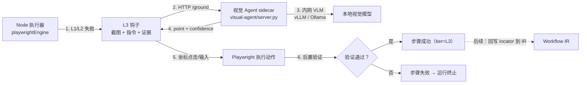

# L3 内网视觉 Agent（设计 + MVP 骨架）

> 2026-10-18 · 对应执行器兜底链 L3：L1 语义定位 → L2 结构证据 → **L3 视觉 Agent** → L4 失败终止 + 自动重编译

## 1. 定位与边界

L3 是**最后一道自动兜底**，只在 L1/L2 都失败、或元素本身不可观测（closed shadow DOM、canvas）时触发。

硬约束：

- **截图 / DOM 快照不出内网**：服务只监听内网地址，模型调用全部在本地/内网完成，禁止任何外部多模态 API；
- **Agent 不碰执行权**：视觉服务只回答「目标在哪」（坐标 + 置信度），点击/输入/验证/回写都由 Node 执行器（Playwright）完成；
- **默认全自动**：低置信度或服务不可用 → 该步骤失败终止，不做人工接管（破坏性操作仍走人工确认闸门）；
- **预算受控**：单步最多 1 次、单次运行默认最多 3 次、单次超时 15s。

## 2. 架构



MVP 只做「**单点 grounding**」：模型回答目标位置，不做多步规划/多轮操作。多步 tool-loop Agent 等单点准确率验证后再考虑。

## 3. 接口协议

`visual-agent/server.py`（Python 标准库实现，mock 后端可直接跑）：

```
GET /health
→ {"status":"ok","backend":"mock","version":1}

POST /ground
{
  "instruction": "任务：点击搜索按钮；说明：...；目标文字：搜索；附近文字：...",
  "currentImage": "data:image/jpeg;base64,...",      // 现场截图（必填）
  "referenceImage": "data:image/jpeg;base64,...",    // 录制时截图（可选）
  "viewport": {"width":1280,"height":800,"dpr":2,"scrollX":0,"scrollY":0},
  "bboxHint": {"x":300,"y":200,"width":120,"height":40}   // 录制时 viewport 坐标（可选）
}
→ {
  "found": true,
  "point": {"x": 0.28, "y": 0.27},   // 归一化到截图（0~1）
  "confidence": 0.92,
  "reason": "...",
  "model": "mock",
  "latencyMs": 3
}
```

坐标换算：`pageX = scrollX + point.x * viewport.width`，`pageY = scrollY + point.y * viewport.height`（截图按 CSS viewport 归一化，DPR 不影响比例）。

## 4. 执行器调用流程

1. L1（录制定位器）失败 → L2（frameChain / shadow 链 / DOM 快照 / 邻近锚点）失败；
2. 检查视觉服务可用性与预算 → 抓现场截图（JPEG q60）+ viewport + 录制参考截图 + `bboxHint`；
3. POST `/ground`，要求 `found=true` 且 `confidence ≥ minConfidence`；
4. 按归一化坐标执行动作（click / dblclick / contextmenu / hover / fill+insertText）；
5. 走统一验证器：显式 `verification` 规则（text/url/title）优先，否则点击类做「页面变化」软信号；
6. 成功：`tier=L3`、`matchedVia=视觉 Agent（模型，置信度）` 写入遥测；失败：步骤失败、运行终止、留存现场截图。

## 5. 配置

环境变量（优先）或 `data/visual-agent.json`（改完无需重启，POC 调试方便）：

```bash
VISUAL_AGENT_URL=http://127.0.0.1:3020   # 不配 = 关闭 L3
VISUAL_AGENT_TIMEOUT_MS=15000
VISUAL_AGENT_MIN_CONFIDENCE=0.6
VISUAL_AGENT_MAX_CALLS_PER_RUN=3
```

```json
{
  "url": "http://127.0.0.1:3020",
  "timeoutMs": 15000,
  "minConfidence": 0.6,
  "maxCallsPerRun": 3
}
```

## 6. 启动与接入真实模型

```bash
# mock 模式（端到端链路可用，不依赖模型）
python3 visual-agent/server.py --host 127.0.0.1 --port 3020
```

接入内网 VLM（二选一）：

- **vLLM**：起 OpenAI 兼容服务（如 `Qwen2.5-VL-7B-Instruct`），在 `ground_with_backend()` 里 POST `/v1/chat/completions`，消息内放 `instruction + image_url(currentImage) + 可选 referenceImage`，要求模型输出 `{"found","point","confidence"}` JSON；
- **Ollama**：`/api/chat` 传 `images`（base64），同样要求 JSON 输出。

解析失败 / 越界坐标 → `found=false` + `reason`；服务只允许监听内网，禁止把截图写入外部日志。

## 7. 验收标准（MVP）

- mock 服务下：L3 步骤成功率 100%（执行器 × 服务契约 × 坐标换算 × 验证链路可用）；
- 预算生效：超过 `maxCallsPerRun` 后不再发起视觉请求，步骤以定位失败终止；
- 服务不可用：健康检查快速失败，不阻塞运行（降级为普通定位失败）；
- 遥测可见：执行历史显示 `L3 视觉 N`，逐步日志包含 `tier=L3`、置信度与验证结果；
- 回归：L1/L2 路径与既有测试全部通过。

## 8. 路线图

| 阶段 | 内容 | 状态 |
|---|---|---|
| MVP | 协议 + mock sidecar + Node 客户端 + 执行器钩子 + 预算 + 遥测 | ✅ 已完成 |
| 下一步 | 接内网 vLLM/Ollama（单点 grounding） | 待做 |
| 之后 | 成功后反查 DOM 并回写 IR（自愈，L3 使用率逐次下降） | 待做 |
| 之后 | 10–20 张截图基准集测准确率，决定是否加多步 tool-loop | 待做 |
| 之后 | closed shadow / canvas 专项用例 + 指标看板 | 待做 |

## 9. 与通用 Agent（DSH / Codex CLI 类）的关系

方向一致，但**不需要通用 Agent**：这里的视觉兜底是窄域任务（给指令 + 截图 → 返回目标点）。通用 Agent 的成本、延迟、权限面都过大；我们只借它的「看 → 定位 → 验证」闭环模式，执行权收敛在 Playwright 执行器里，安全边界更清晰。
