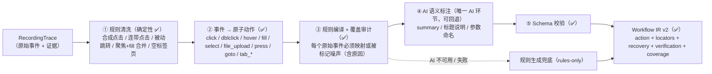
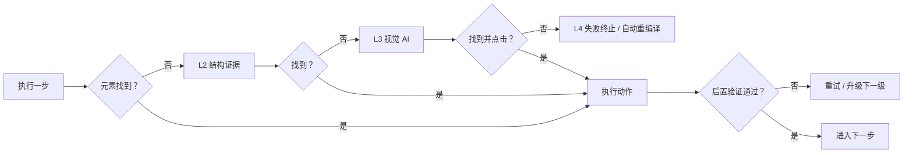
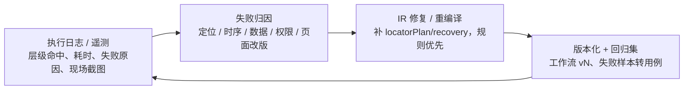

# 录制 → 翻译 → 执行：能力边界、缺陷与分层兜底

> 讨论记录 · 2026-10-18 · 对应图：[`pipeline-robustness.png`](./pipeline-robustness.png)（矢量版 [`pipeline-robustness.svg`](./pipeline-robustness.svg)）
>
> 结论先行：**三段式方向成立**，但你提到的三类缺陷需要换一个视角来解：不是"把某一环做得更聪明"，而是**把失败当作一等公民**——录制端存证据、翻译端留退路、执行端做验证、系统端能自愈。

## 0. 一句话结论

| 你的判断 | 我的评估 |
|---|---|
| 录制器可能录不全 | ✅ 成立，而且比想象的更受限：不是"录得少"，而是**有些东西根本不可观测**（closed shadow DOM、canvas、原生弹窗、跨域限制） |
| 翻译器可能清洗错/丢信息 | ✅ 成立，但问题不在"翻译成 JSON 给 Playwright"这个格式，而在于**有损压缩不可审计、不可回退** |
| 执行器需要 L1/L2/L3 兜底 | ✅ 方向对，但**顺序对、缺两层**：缺"验证器"（判断这步到底成没成）和"L4 人工自愈"（把失败沉淀成能力） |
| AI 视觉是最保险的兜底 | ⚠️ 部分不同意：视觉是最**通用**的自动化兜底，但不是最**可靠**的——慢、贵、非确定、会误点。而且本产品**截图不得出域**，视觉兜底只能是本地/内网能力 |

### 0.1 已确认的产品约束（2026-10-18）

| 决策项 | 结论 | 对架构的直接约束 |
|---|---|---|
| 录制入口 | **固定用受控 Chromium，不做真实浏览器扩展** | 录制器不引入扩展；保留 `RecorderSource` 作为远期可选扩展点 |
| 目标页面 | **公网任意站点** | 必须重投 L1/L2 证据质量；页面改版靠自动重编译；视觉兜底受合规限制 |
| 失败容忍 | **全自动跑完，不做人工接管** | 失败 = 终止 + 告警 + 自动重编译；L3 是最后一道自动手段 |
| 破坏性操作 | 提交 / 支付 / 删除**需人工确认** | 人工确认是"审批闸门"，不是"接管"：执行到该步暂停等确认 |
| 数据合规 | 截图 / DOM 快照**不得发送给外部多模态模型** | 允许**内网 / 本地部署的视觉模型**（截图不出网）；外部多模态 API 排除 |

## 1. 三个阶段的本质问题不一样，不能用同一招解决

| 阶段 | 本质问题 | 为什么难 | 正确解法 |
|---|---|---|---|
| 录制器 | **可观测性问题**（Observability） | 受浏览器 API 物理边界限制，有些 DOM 根本读不到 | 最大化证据 + **显式标注不可观测** + 能力契约 |
| 翻译器 | **有损语义压缩问题**（Semantic Compression） | 噪声清洗和意图保留天然矛盾；AI 输出不可复现 | **确定性清洗为主，AI 只做语义标注** + Schema 校验 + 覆盖审计 |
| 执行器 | **可复现性问题**（Reproducibility） | 页面会变、时序会漂、环境会差异 | 分层定位 + **动作后置验证** + 重试/取消 |
| （缺失）验证器 | **成败判定问题** | 目前"不抛异常 = 成功"，这是假成功 | 每步前置条件 + 后置断言，失败即升级 |

> 关键洞察：**断层不是发生在某一环，而是信息在流水线上逐层丢失**。录制时没存证据 → 翻译时无法验证 → 执行时没有退路。所以修复要从数据契约开始，而不是从模型开始。

## 2. 录制器：先承认"不可能全录"，再定义"录到什么程度够用"

### 2.1 当前能力矩阵（对照 `server/playwrightEngine.ts` 的真实实现）

| 交互类型 | 现状 | 说明 / 风险 |
|---|---|---|
| 单击 click | ✅ | 捕获阶段监听，会 `closest()` 归并到"可交互祖先" |
| 双击 dblclick | ✅ | 单击延迟 220ms 落库，双击合并为单条 `dblclick`，不再产生两条 click |
| 右键 / contextmenu | ✅ | 记录 `contextmenu`，回放 `click({ button: 'right' })` |
| 悬停 hover / mouseenter | ✅ | 驻留 450ms 才记录，按可交互元素 / `cursor:pointer` 过滤，避免划过噪声 |
| 拖拽 drag & drop | ✅ | dragstart/drop 合并为单条 `drag`，源与落点分别带定位器，回放 `dragTo()` |
| 滚动 scroll / wheel | ✅ 录制 / △ 清洗 | 仅主文档、节流 350ms、位移 ≥200px 才记录；清洗阶段作为轨迹证据剔除（Playwright 会自动滚动到目标） |
| 文件上传 input[type=file] | ✅ | 单独记为 `file_upload`（文件名）；回放需参数化为文件绝对路径 |
| 富文本 contenteditable | ✅ | 以 `fill` 记录，回放 `fill()` + `innerText` 回退校验 |
| 勾选 / 单选 | ✅ | 通过 click 事件可复现 |
| 下拉选择 select | ✅ | change 事件 |
| 普通输入 | ✅ | input 事件，连续输入自动合并 |
| Enter / Escape | ✅ | keydown 只监听这两个键 |
| 其他按键 | △ | 支持 Enter / Esc / Tab / 方向键；输入框内可打印字符由 `fill` 覆盖，组合键仍不录 |
| 标签页 新建 / 关闭 | ✅ | `context.on('page')` + `page.on('close')` |
| 标签页 切换 | △ | 未显式记录"激活"事件，但每个事件带 `tabId` 可推断操作顺序 |
| 页面导航 navigate | ✅ | `framenavigated`，被动跳转会在翻译阶段剔除 |
| iframe 内事件 | ✅ 录制 / ❌ 回放 | 采集脚本注入到所有 frame（`frameUrl` 有记），**但执行器只查主 page，没有任何 frameLocator** |
| open shadow DOM | △ | Playwright 的 role/text 定位可穿透；但 `cssPath` 用 `parentElement` 上溯，**到 shadow root 就断链**，xpath 同理 |
| closed shadow DOM | ❌ | 页面 JS 和 Playwright 都读不到，只能靠视觉 |
| canvas / WebGL（地图、设计工具） | ❌ | 没有 DOM，只能靠视觉 |
| 原生弹窗 alert/confirm/prompt | △ | 录制时注册 `dialog` 处理器：记录类型与文案并**自动 accept**（受控浏览器下无法让用户真实选择）；回放时若工作流含 dialog 步骤同样自动 accept |
| 下载 | △ | 记录 `download` 事件（文件名/URL）作为轨迹证据；清洗阶段剔除，回放由点击重新触发下载 |
| 新窗口 / popup | ✅ | `context.on('page')` 覆盖 |
| 视口 / DPR / 缩放 / 滚动位置 | ❌ | 视觉兜底和坐标回放都依赖这些 |

### 2.2 "不可观测"是物理边界，不是 bug

必须接受三件事：

1. **closed shadow DOM 的内容**：页面自身 JS 都拿不到，外部工具更拿不到；
2. **canvas / WebGL 内部元素**：页面里只有一个 canvas 节点；
3. **跨域 iframe 的内部细节**：受同源策略限制（Playwright 能控制，但注入脚本读属性仍有边界）。

对这类操作，正确做法不是"想办法录到"，而是**录到能兜底的最小证据**：坐标 + 截图 + 页面 URL + 视口信息，并标记 `observability: "visual-only"`。到了执行器，它就知道"这步只能走视觉兜底"。

### 2.3 证据清单 v2：为未来执行器"未卜先知"地采集

现在每个事件只存了 `pageContext + action + target(7 种 locator) + screenshot`。建议扩充为**证据包**：

```ts
interface RecordedEventV2 {
  // ...现有五层字段
  target: {
    rawTarget: TargetEvidence       // 用户真正点中的元素（现在被 closest 吞掉了）
    interactiveTarget: TargetEvidence
    frameChain: FrameRef[]          // [{ url, name, index }] 而不是只有最后一层 frameUrl
    shadowChain: string[]           // shadow host 链，用于 re-root 定位
    observability: 'dom' | 'open-shadow' | 'closed-shadow' | 'visual-only'
  }
  evidence: {
    domSnapshot?: string            // 目标 + 祖先的 outerHTML 片段（截断，脱敏）
    accessibleName?: string         // ARIA 可访问名，比 innerText 稳定
    nearbyText?: string[]           // 最近标题 / label / 兄弟文本（相对锚点）
    boundingBox?: Rect              // 录制时坐标
    viewport?: { width, height, dpr, scrollX, scrollY }
    screenshotBefore?: string       // 动作前
    screenshotAfter?: string        // 动作后（验证用）
  }
  // 动作后的"结果证据"：给执行器当断言用
  outcome?: {
    urlChanged?: boolean
    titleChanged?: boolean
    textsAdded?: string[]           // 页面上新增的短文本（最多 3 条）
    domHashChanged?: boolean        // 目标子树结构哈希
  }
}
```

**这份证据包是 L2 兜底的全部弹药**。现在缺失的 `frameChain`、`shadowChain`、`domSnapshot`、`outcome` 一旦补上，即使页面改版，执行器也有很大概率自己找回来。

### 2.4 输出"能力契约"，而不是假装全能

录制结束时产出一份 manifest：

```
本次录制覆盖：dom 82% / open-shadow 9% / closed-shadow 4% / visual-only 5%
警告：有 2 个操作位于 closed shadow DOM，回放将依赖视觉兜底，稳定性较低
```

前端在开始录制前就把这句话告诉用户。**把不可靠提前暴露，比执行时莫名失败体验好得多**。

### 2.5 录制入口的选择（产品决策，不是技术细节）

| 方案 | 优势 | 代价 |
|---|---|---|
| 现状：受控 Chromium（Playwright 持久化 profile） | 完全可控、SSO 可用、注入无限制 | 用户要切换到"自动化浏览器"，不是日常浏览器 |
| 浏览器扩展（content script + debugger） | 在用户真实浏览器里录，体验自然 | MV3 生命周期、权限弹窗、跨域限制、审核成本 |

**可行性结论**：数据契约层面不难——把录制器抽象成 `RecorderSource`、输出统一的 `RecordingTrace` 即可，扩展只是另一个 source。工程难度中等偏难：

| 路线 | 保真度 | 主要难点 |
|---|---|---|
| 内容脚本（content script） | 中 | MV3 service worker 生命周期、跨域 iframe 需逐域 host 权限、截图要 `tabs.captureVisibleTab` 权限、原生弹窗/下载拿不到 |
| `chrome.debugger`（CDP） | 高（接近 Playwright） | 顶部"正在调试"横幅、与 DevTools 冲突、企业策略可能禁用、商店审核更严 |

粗略工作量：内容脚本版原型 1–2 周（click/input/select/导航/标签页 + 截图 + 复用现有 locator 生成）；生产级 4–8 周（OOPIF、keepalive、SSO、隐私合规、企业分发）。

另外一个要提前想清楚的点：**录制在真实浏览器、回放在受控 Chromium，会带来会话/扩展/分辨率差异**。如果认真做扩展，最好录制与回放同源（都用扩展驱动），否则回放稳定性会打折。

**已决策（2026-10-18）：暂不做真实浏览器录制，固定用受控 Chromium**。上面的评估保留作为远期参考；`RecorderSource` 抽象仍可保留，但不投入开发。

## 3. 翻译器：把"AI 一次翻译"改成"确定性流水线 + AI 语义标注"

### 3.1 v3 实现状态（已完成，2026-10-18）

翻译器已拆成 **确定性规则层（`server/compiler.ts`）+ AI 语义标注层（`server/ai.ts`）**：

- **规则清洗**：0 尺寸合成点击、回车后 100ms 内合成点击、50ms 内 label 连带点击、被动 navigate、聚焦点击+fill 合并、空标签页开→关、悬停划过噪声；被动跳转的 URL 会转成上一步的 URL 后置校验；
- **规则编译**：原子动作 → `OperationWorkflow`，**AI 不可用或失败时仍能产出可执行工作流**（`v3-rules@1+rules-only`）；
- **AI 只做语义标注**：整条 summary、每步标题/说明、参数命名；提示词禁止增删动作、禁止生成/修改定位器；标注结果必须通过 Schema 校验，且必须覆盖所有 stepId；
- **AI 失败自动回退**：`v3-rules@1+fallback`，并在 `coverage.warnings` 中记录原因；
- **可审计**：`coverage.dropReasons` 给出每类噪声的剔除数量，`translatorVersion` 标明本次走的路径。

v1 时代"一次 AI 调用产出整份工作流"的风险（不可复现、不可审计、无 Schema、幻觉、过度清洗）已按下面的流水线逐项解决。

### 3.2 建议的流水线



**分工原则**：

| 交规则（确定性、可测试） | 交 AI（语义、模糊） |
|---|---|
| 合成点击 / 连带点击剔除 | 步骤的自然语言标题/说明 |
| click + fill 合并 | 参数语义命名（`searchKeyword` 还是 `productName`） |
| 被动 navigate 剔除 | 固定的"固定"还是该"参数化"的边界判断 |
| 空标签页开→关剔除 | 用户注释与步骤的关联 |
| locator 排序、参数默认值提取 | 高度模糊的噪声判定（需给置信度） |
| Schema 校验、覆盖审计 | ——（不负责生成 locator） |
| 固定/参数化判定（fill/select/file_upload） | 参数英文命名与中文说明 |

> 实现上还额外保证：每个参数化步骤带 `paramKey` 绑定、`boundStepIds` 反向引用；AI 标注缺失/非法时整体回退规则生成，不会产出半份工作流。

### 3.3 Workflow IR v2（已落地字段）

现在的 `OperationWorkflow` 只回答"做什么"，v2 要回答"**找不到时怎么办**"：

```ts
interface WorkflowStepV2 {
  id: string
  order: number
  intent: {
    title: string          // 给人看
    description: string
    category: 'fixed' | 'parameterized'
    paramKey?: string
  }
  action: {
    tabId: string
    frameChain?: FrameRef[]
    type: 'goto' | 'click' | 'fill' | 'select' | 'press' | 'tab_open' | 'tab_close' | 'wait' | 'assert'
    value?: string
    paramKey?: string
  }
  // L1：语义定位主路径（按稳定性排序，不是按录制顺序）
  locatorPlan: Array<{
    strategy: 'testId' | 'role' | 'label' | 'text' | 'id' | 'css' | 'xpath'
    value: string
    confidence: number
    source: 'recorded' | 'derived'
  }>
  // L2：结构恢复证据（失败时用）
  recovery?: {
    frameChain?: FrameRef[]
    shadowChain?: string[]
    domSnapshot?: string
    nearbyText?: string[]
    boundingBox?: Rect
  }
  // L3：视觉兜底素材
  visual?: {
    referenceScreenshot?: string   // 录制时截图
    instruction: string            // 给多模态模型的自然语言指令
    bbox?: Rect
  }
  // 验证：这一步怎样算成功
  verification?: {
    mode: 'url' | 'title' | 'text' | 'value' | 'dom-change' | 'none'
    expected?: string
    timeoutMs?: number
  }
  provenance: string[]             // 对应的原始事件 id（现有 sourceEventIds）
}

interface OperationWorkflowV2 {
  schemaVersion: 2
  projectId: string
  translatorVersion: string        // 翻译器版本，便于重编译
  summary: string
  parameters: WorkflowParameter[]
  steps: WorkflowStepV2[]
  recordingManifest: {             // 录制能力契约：不可观测操作的占比与告警
    observability: Record<'dom' | 'open-shadow' | 'closed-shadow' | 'visual-only', number>
    warnings: string[]
  }
}
```

> 为什么继续用"声明式 JSON"而不是"生成 Playwright 代码"：**安全**（不执行模型生成的代码）、**可测试**（IR 可做 schema 校验/回归）、**可迁移**（未来换执行引擎不用重录）。这一点你现在的方向是对的，只是需要把 IR 变成"可修复的资产"。

## 4. 执行器：从"一次尝试"到"分层兜底 + 验证"

### 4.1 四级阶梯（你的 L1/L2/L3 + 我补的 L4）

| 层级 | 手段 | 触发条件 | 成本 | 可靠性 | 失败信号 |
|---|---|---|---|---|---|
| **L1 语义定位（主路径）** | `getByTestId` / `getByRole(name)` / `getByLabel` / `getByText`，Playwright 自动等待 | 默认 | 低 | 高（页面语义稳定时） | 找不到 / 不可见 / 不可交互 |
| **L2 结构证据恢复** | `frameLocator(frameChain)` 进 iframe · shadow host 链 re-root · DOM 快照重新推导 · 邻近锚点（标题/label/兄弟文本）· bbox + 滚动 + 视口归一化 | L1 失败 | 中 | 中（页面改版后失效） | 仍找不到 / 匹配歧义 |
| **L3 内网视觉模型兜底** | 运行时截图 + 录制参考截图 + bbox → 内网部署的视觉模型（截图不出网）→ 候选坐标 → **点击后立即验证**；模板/OCR 作为轻量补充 | L2 失败或元素 `visual-only` | 中-高（受本地算力约束） | 中（比模板匹配强，但仍需验证） | 置信度低 / 验证失败 |
| **L4 失败终止 + 自动重编译** | 终止本次运行 → 记录失败现场 → 用新证据自动重编译 IR（规则优先、版本化可回滚）→ 告警 | L3 仍失败 / 验证连续失败 | 低（自动） | ——（本次不成功，但沉淀能力） | —— |

关键点：

1. **顺序按"成本 × 可验证性"排**：视觉放最后，因为它最不可验证；
2. **每一级都必须通过验证器**，"找元素成功"不等于"操作成功"；
3. **没有人工接管**：L4 只做"失败终止 + 自动重编译 + 告警"，失败样本自动沉淀为回归与重编译输入；
4. **视觉截图必须现场取**：录制参考截图 + 运行时截图 + bbox，并按 viewport/DPR/scroll 归一化。

### 4.2 验证器：每次动作后都要回答"这步成了吗"

现在执行器是"固定 sleep 后继续"，**不抛异常就算成功**。这是最大的假成功来源。建议每步带两个断言：

| 断言 | 来源 | 例子 |
|---|---|---|
| 前置条件 precondition | 录制时的页面状态 | 页面在 `/orders`、列表存在"待审批"按钮 |
| 后置条件 verification | 录制时的 `outcome` 证据 | URL 变成 `/orders/123`、标题含"订单详情"、出现文本"保存成功" |



### 4.3 视觉兜底的使用边界（受合规约束）

- **截图 / DOM 快照不得出网** → 只允许内网 / 本地部署的视觉模型（模板匹配、OCR 作为轻量补充）；外部多模态 API 直接排除；
- **只在 L3**：不做"翻译"、不生成定位器，只输出候选 + 置信度；
- **必须现场截图** + 录制参考截图 + bbox，坐标按 viewport/DPR/scroll 归一化；
- **点击后必须验证**；置信度低于阈值就按失败终止（无人接管）；
- **破坏性操作暂停等待人工确认**：这是审批闸门，不是接管；
- 内网模型能力受本地算力与模型规模限制，但比纯模板匹配强，可承担 `closed shadow` / `canvas` 等长尾；指标上要如实体现。

## 5. 反馈闭环：让失败变成资产



**必须采集的遥测**（现在完全没有）：

- 每步命中的层级（L1/L2/L3/L4）、总耗时、升级次数；
- 失败原因分类（元素找不到 / 不可交互 / 验证失败 / 超时 / 权限）；
- 现场截图与页面 URL（脱敏后）；
- 同一步在不同执行中的成功率和层级分布。

**必须定义的指标**：

| 指标 | 含义 | 目标方向 |
|---|---|---|
| L1 命中率 | 语义定位直接成功的比例 | 越高越好（反映录制/翻译质量） |
| L2 自愈率 | 靠结构证据救回的比例 | 中高（反映证据质量） |
| L3 使用率 | 视觉兜底触发比例 | 低（说明前两层够用） |
| 失败终止率 | 整条流程失败终止的比例 | 越低越好 |
| 破坏性操作确认次数 | 需要人工审批的步骤数 | 按业务预期 |
| 平均恢复耗时 | 从失败到恢复的时间 | 越低越好 |
| 误操作率 | 验证未通过但已产生副作用的比例 | 必须趋近 0 |

**安全与隐私**：截图和 DOM 快照可能含 PII / 密钥，需要脱敏、加密、保留策略；**截图不出域**是硬约束，视觉兜底只能走本地/内网能力。

## 6. 与当前代码的具体差距（可执行清单）

| 优先级 | 差距 | 现状证据 | 建议动作 |
|---|---|---|---|
| ✅ P0 | 执行器不支持 iframe | `frameUrl` 只记录，`executeWorkflowStep` 只用主 `page` | **已实现单层 `frameUrl`**（`page.frames()` 匹配后执行）；多层 `frameChain` 留 P1 |
| ✅ P0 | 动作后无验证 | 只有固定 `waitForTimeout`，没有断言 | **已实现最小校验**：fill/select 校验值、goto 校验 URL、显式 text/url/title/value；click/press 软信号 |
| ✅ P0 | 无执行遥测 | `RunRecord` 只有 note/duration | **已实现**：`RunRecord.logs` 记录命中策略、耗时、校验结果、失败原因，并在历史弹窗展示 |
| ✅ P0 | 固定 sleep | click/fill/select 350ms、press 600ms、goto 400ms | **已替换**：goto 等网络空闲、动作用「URL/正文变化」效果检测；press 保留 2.5s 效果窗口 |
| ✅ P1 | `cssPath` / `xpath` 跨 shadow 断链 | `parentElement` 上溯到 shadow root 即停 | **已实现** `shadowChain` + Playwright `>>` 链式选择器（L2 恢复） |
| ✅ P1（完成） | 录制覆盖窄 | 只有 click/input/change/keydown/mouseup | **已补** hover（防抖）/ dblclick（合并）/ contextmenu / drag / scroll / dialog / download / contenteditable / file_upload / Tab·方向键；剩余限制仅 closed shadow、canvas、组合键 |
| ✅ P1 | 证据不完整 | 无 DOM 快照、无前后截图、无视口信息、无 outcome | **已实现** `frameChain` / `shadowChain` / `domSnapshot` / `viewport`；截图沿用每事件快照；`outcome` 用「后续事件」在翻译阶段推导 |
| ✅ P1（部分） | 翻译器单次 AI、无 Schema | `ai.ts` 直接调用 + 手工归一化 | **已实现** Schema 校验、覆盖审计、`translatorVersion`、证据增强与校验生成；规则清洗从 AI 拆出仍待 P2 |
| ✅ L3 MVP | 视觉兜底未落地 | 截图只用于录制展示 | **已落地骨架**：`visual-agent` sidecar（mock `/ground`）+ 参考/现场截图 + 置信度阈值 + 预算 + 验证 + `tier=L3` 遥测；真实内网 VLM 待接 |
| **P2** | 无取消 / 总超时 | 异步任务只能等 | `AbortController` + 取消接口 + 全局 deadline |
| ✅ P1 | 无失败告警 | 失败只写 `RunRecord` | **已实现** 失败步骤现场截图 + 页面 URL + `ALERT_WEBHOOK_URL` 推送 |
| **P2** | 无自愈 / 版本化 | 失败即结束 | 失败终止 + 自动重编译（版本化可回滚）+ 回归集 |
| **P2** | 录制入口单一 | 受控 Chromium | 已决策：暂不做真实浏览器扩展；仅保留 `RecorderSource` 抽象 |

> 其中 **iframe 不支持**这一条最"显性"：现在如果用户录了 iframe 里的操作，翻译阶段可能能过（`frameUrl` 只是元数据），但执行阶段 100% 失败——而且会以"元素找不到"这种误导性理由失败。建议作为第一个修的。

## 7. 演进路线（按投入产出排序）

### 阶段一：先让失败"可解释"（✅ 已完成，2026-10-18）

1. 执行器支持 `frameUrl`（单层 iframe）；`frameChain` 后续补；
2. 加最小验证器：URL / 标题 / 关键文本断言；
3. 固定 sleep 换成显式 `waitFor`；
4. 每步记录执行日志（层级、耗时、失败原因）并写进 `RunRecord` 的 note 或独立 JSON；
5. 失败时截图存档，供人工排查。

> 预期收益：把"执行失败但不知道哪一步、为什么"变成"能定位、能复现"。

### 阶段二：把证据链补起来（✅ 已完成，2026-10-18）

1. 录制器 v2：`frameChain` / `shadowChain` / DOM 快照 / viewport（每事件截图已具备）✅
2. 翻译器：Schema 校验 + 覆盖审计 + 证据增强 + 校验生成 ✅（规则清洗从 AI 中拆出仍待 P2）
3. 执行器 L2：嵌套 frameChain、shadow 链、DOM 快照推导、邻近锚点 ✅
4. 失败现场截图 + Webhook 告警 ✅

> 预期收益：页面小改版、iframe、动态 id 类失败大幅下降；翻译结果可回归测试。

### 阶段三：兜底与自愈（产品化阶段）

1. L3 内网视觉 Agent：协议 + mock sidecar + 执行器钩子 + 预算/降级/遥测 ✅（真实 VLM、自愈回写、准确率基准集待做，见 `L3-VISUAL-AGENT.md`）；
2. L4 失败终止 + 自动重编译 + 版本化回滚 + 回归集 + 失败告警 ✅（重编译为自动告警闭环，回归集待补）；
3. 遥测看板与指标；隐私脱敏与不出网审计。

## 8. 已确认决策与遗留问题

已确认（2026-10-18）：

| 决策项 | 结论 |
|---|---|
| 录制入口 | 固定用受控 Chromium，不做真实浏览器扩展 |
| 目标页面 | 公网任意站点 |
| 失败容忍 | 全自动跑完，不做人工接管 |
| 破坏性操作 | 提交 / 支付 / 删除需人工确认（审批闸门，不接管） |
| 数据合规 | 截图 / DOM 快照不得出网；**允许内网 / 本地部署的视觉模型**，排除外部多模态 API |

决策已闭环，无遗留问题。

---

**一句话总结**：三段式方向成立，三个缺陷也全部成立；真正要补的是**第四段（验证器）**和**贯穿三段的证据链**。在"公网任意站点 + 全自动 + 截图不出网但可用内网视觉模型"的约束下，稳定性上限由**录制证据质量 + L1/L2 确定性恢复 + L3 内网视觉长尾兜底**共同决定。
